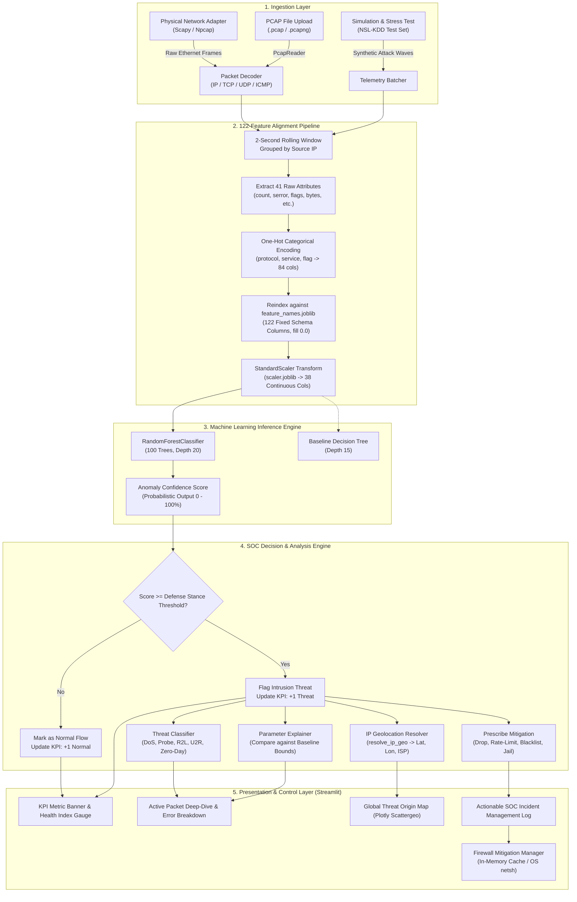

# ShieldNet AI: Architecture & System Flow Blueprint
**Next-Generation Network Health & Real-Time Anomaly Operations Center (NIDS)**

---

## 1. Executive Summary

**ShieldNet AI** is an enterprise-grade Network Intrusion Detection and Prevention System (NIDS/NIPS). It bridges low-level network packet inspection (via Scapy/Npcap) with machine learning inference using a 122-feature alignment pipeline (trained on the benchmark NSL-KDD dataset with Random Forest and Decision Tree ensembles).

The platform features:
- **Dual-Mode Telemetry Ingestion**: Live physical network adapter sniffing & controlled scenario replay simulation.
- **Strict 122-Feature Alignment Pipeline**: Dynamic one-hot categorical expansion, unseen-category zero-filling, and continuous feature standard scaling.
- **Explainable Anomaly Classification**: Fine-grained error breakdown (DoS SYN floods, Port Scans, Brute-Force R2L, Privilege Escalation U2R, and Zero-Day variants) with comparison against normative baselines.
- **Geospatial Threat Intelligence**: Real-time IP geolocation mapping suspicious public endpoints across an interactive world map.
- **Actionable Active Defense**: One-click in-memory IP blocking and OS firewall rule enforcement (`netsh advfirewall` on Windows / `nftables` on Linux).

---

## 2. End-to-End System Architecture



---

## 3. Detailed Data Flow Stages

### Stage 1: Ingestion & Connection Aggregation
Traffic arrives from three possible sources:
1. **Live Network Adapter**: Scapy’s `sniff()` captures live IP datagrams from the active physical network card (Npcap on Windows, raw sockets on Linux).
2. **Replay Simulator**: Rows are sampled from the 22,544-record `KDDTest+.txt` test set according to user-selected scenarios (e.g., DoS Neptune, Nmap Probes, R2L Passwd, or Zero-Day variants).
3. **Forensic PCAP File**: Scapy’s `PcapReader` iterates through packet streams from uploaded captures.

Packets are grouped by `source_ip` over rolling 2-second time windows. Transport layer ports are mapped into standard service identifiers (e.g., port 80/443 $\rightarrow$ `http`/`http_443`, port 53 $\rightarrow$ `domain_u`, port 22 $\rightarrow$ `ssh`).

### Stage 2: 122-Feature Alignment Pipeline (`preprocess_traffic_samples`)
The ML models require a fixed 122-dimensional numerical vector. The preprocessing sequence:
```
Raw Flow Attributes (41 dimensions)
  │
  ├── 1. Drop targets & metadata: 'attack', 'difficulty_level'
  ├── 2. Isolate categorical columns: ['protocol_type', 'service', 'flag']
  ├── 3. One-hot encode categoricals: pd.get_dummies() -> 84 sparse columns
  ├── 4. Column Schema Alignment: df.reindex(columns=feature_names, fill_value=0.0)
  │      * Unseen attack services in zero-day packets safely evaluate to 0.0 without crashing
  └── 5. Continuous Feature Scaling: scaler.transform() on the 38 continuous features
         * Mean-centered and scaled to unit variance using pre-fitted parameters
```

### Stage 3: Inference & Decision Boundaries
The normalized 122-feature vector is passed to `advanced_model.joblib`:
- **Model**: `RandomForestClassifier` (100 estimators, max depth 20, random_state=42).
- **Inference Output**: Probabilistic array `[P(Normal), P(Intrusion)]`.
- **Defense Stance Filtering**: The raw intrusion probability is matched against the active operational defense stance:
  - **Balanced Protection**: $\tau = 0.50$ (Balanced, production standard)
  - **High Vigilance**: $\tau = 0.35$ (Sensitive to low-rate reconnaissance)
  - **Strict Lockdown**: $\tau = 0.20$ (Aggressive zero-tolerance quarantine)

### Stage 4: Error-Specific Breakdown & Explainability
When an intrusion is identified, `analyze_anomaly_parameters()` audits the flow attributes against normal operational bounds:
- **Connection Volume Surge**: Flagged if `count >= 60` connections/2s window (benchmark: $< 15$).
- **SYN Handshake Error Rate**: Flagged if `serror_rate >= 35%` (benchmark: $< 5\%$).
- **Anomalous TCP Flags**: Flagged on `S0` (half-open SYN), `REJ`/`RSTO` (connection reset/rejected).
- **Service Port Dispersal**: Flagged if `diff_srv_rate >= 35%` (indicates horizontal/vertical port scans).
- **Zero-Byte Payload Exchange**: Flagged if `src_bytes == 0` and `dst_bytes == 0` during high connection counts.
- **Authentication Failures**: Flagged if `num_failed_logins >= 1`.
- **Privilege Escalation**: Critical alert if `root_shell == 1` or `su_attempted == 1`.

### Stage 5: Geospatial Threat Intelligence
Suspicious public source IPs are processed through `resolve_ip_geo()`:
- **RFC 1918 Private Addresses** (`192.168.x.x`, `10.x.x.x`, `172.16.x.x`, `127.0.0.1`) are categorized as `🏠 Internal LAN`.
- **Public IPs** are resolved via `http://ip-api.com/json/{ip}` to retrieve Latitude, Longitude, Country Name, Country Code, City, and ISP/Autonomous System.
- Lookups are cached in-memory (`@st.cache_data(ttl=86400)`).
- Coordinates are plotted on an interactive **Plotly Scattergeo World Map** with hover metadata and regional origin ranking.

### Stage 6: Health Index & Active Mitigation
1. **Dynamic Network Health Index**:
   Calculated over a sliding window of the last 60 inspected flows:
   $$\text{Threat Ratio} = \frac{M_{\text{unmitigated}} + 0.25 \times M_{\text{mitigated}}}{N_{\text{window}}}$$
   $$\text{Health Index} = \max(0.0, \min(100.0, 100.0 \times (1.0 - 1.6 \times \text{Threat Ratio})))$$
2. **Mitigation Enforcement**:
   - **In-Memory Deny Cache**: Blocks IP from session communication.
   - **OS Firewall Integration**: Executes platform-specific rules (`netsh advfirewall firewall add rule` on Windows / `nft add rule` on Linux) upon confirmation.

---

## 4. Repository File Map & Responsibilities

| File Path | Role & Operational Responsibility |
| :--- | :--- |
| [app.py](file:///c:/Users/Dev%20Kumar%20Sonkar/OneDrive/문서/development/Network-Watcher/app.py) | **Primary Operations Center Application**. Houses the Streamlit UI, Defense Stance controller, live Scapy sniffer, 122-feature pipeline, IP geolocation engine, and Plotly world map. |
| [shieldnet.py](file:///c:/Users/Dev%20Kumar%20Sonkar/OneDrive/문서/development/Network-Watcher/shieldnet.py) | **Core Network & Mitigation Engine**. Provides `RuntimeState`, `MitigationManager`, Scapy packet decoders, session audit report generation (TXT/PDF), and OS firewall wrappers. |
| [step1_load_data.py](file:///c:/Users/Dev%20Kumar%20Sonkar/OneDrive/문서/development/Network-Watcher/step1_load_data.py) | Defines the 43 standard NSL-KDD column schemas and path resolution utilities (`resolve_dataset_path`). |
| [step2_preprocess.py](file:///c:/Users/Dev%20Kumar%20Sonkar/OneDrive/문서/development/Network-Watcher/step2_preprocess.py) | Defines attack categorization mapping (`ATTACK_MAPPING`) into DoS, Probe, R2L, and U2R taxonomies. |
| [step3_train_models.py](file:///c:/Users/Dev%20Kumar%20Sonkar/OneDrive/문서/development/Network-Watcher/step3_train_models.py) | Trains and serializes `advanced_model.joblib`, `baseline_model.joblib`, `scaler.joblib`, and `feature_names.joblib`. |
| [step5_feature_importance.py](file:///c:/Users/Dev%20Kumar%20Sonkar/OneDrive/문서/development/Network-Watcher/step5_feature_importance.py) | Extracts Gini feature importances from tree-based models and exports visual importance charts. |
| [soc_copilot.py](file:///c:/Users/Dev%20Kumar%20Sonkar/OneDrive/문서/development/Network-Watcher/soc_copilot.py) | **AI SOC Copilot & Incident Forensics Engine**. Provides root-cause diagnosis, MITRE ATT&CK mapping, plain-English executive incident briefings, copy-ready firewall mitigations, and conversational incident interrogation. |
| [models/](file:///c:/Users/Dev%20Kumar%20Sonkar/OneDrive/문서/development/Network-Watcher/models) | Directory containing serialized machine learning artifacts: `advanced_model.joblib` (Random Forest), `scaler.joblib`, and `feature_names.joblib`. |
| [tests/](file:///c:/Users/Dev%20Kumar%20Sonkar/OneDrive/문서/development/Network-Watcher/tests) | Pytest test suite (`test_dashboard_pipeline.py`, `test_shieldnet.py`) validating model loading, 122-feature alignment, geolocation, and firewall rules. |

---

## 5. Verification & Testing

To execute automated test suites validating the end-to-end pipeline:
```bash
python -m pytest tests
```

To run the live Security Operations Center dashboard:
```bash
streamlit run app.py
```
